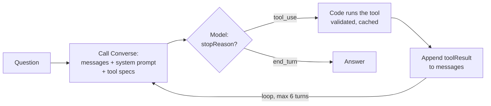

# FinOps Agent: an AWS cost agent built from scratch, then in Strands

An AI agent that answers questions about a real AWS bill ("Why did my spend change?", "What did Bedrock cost me this month?") by calling Cost Explorer through tools on Amazon Bedrock.

I built it twice on purpose:

1. **By hand** on the Bedrock Converse API, to understand exactly what an agent framework does.
2. **In [Strands Agents](https://strandsagents.com)**, reusing the same tools, prompt and model, so that the only difference is who runs the loop.

Both are graded by the same **eval suite**, which took the agent from **74% to 100%** in four measured rounds.

---

## What it does

An example from a real run, trimmed:

```text
$ python strands_agent.py "How has my AWS spend changed over the last three full months?"

    tool: compare_periods({'start_month': '2026-08', 'end_month': '2026-10'})

Bill down 14.3% ($24.05 → $20.62), but usage up 38.8% ($12.91 → $17.93).
Main driver: AWS Key Management Service (+$3.01, 60% of the usage increase).
One-off: an $8.00 "Other" charge in August made the August bill higher than usual.
```

The bill and usage moving in opposite directions, and a one-off charge distorting the comparison, are exactly what early versions of the agent got wrong. See [the eval journey](#the-eval-journey-74--100).

---

## How the agent works

An agent is a loop. The model never runs anything: it asks for a tool, the code runs it, and the result goes back until the model is done.



---

## Repository

| File | What it is |
| --- | --- |
| `agent_loop.py` | The hand-built agent: Steps 1–5 from a single Converse call to the full loop, with retries, a turn limit and a trace |
| `cost_tools.py` | The four Cost Explorer tools, the tool menu and the system prompt template. Shared by both engines |
| `strands_agent.py` | The same agent in Strands: `@tool` wrappers plus two hooks (a turn limit and trace recording) |
| `evals.py` | Eval suite: 5 cases, 38 checks, run on either engine (`--engine handbuilt` or `--engine strands`) |
| `isolate.py` | Debugging script that varies one thing at a time to pin down a model bug |
| `submit_use_case.py` | Helper for Bedrock's one-time Anthropic model access form |

---

## The tools

The tools are designed around the questions users ask, not around the raw API. All arithmetic happens in code; the model only explains the results.

| Tool | Answers | Cost Explorer requests |
| --- | --- | --- |
| `get_monthly_spend` | The whole account's bill for one month, split into usage, tax, credits and other charges | 1 |
| `get_spend_by_service` | Which services drove a month's usage (top N plus an "all other" bucket) | 1 |
| `get_daily_spend` | When a change started, per day, optionally for one service | 1, plus 1 to check the service name |
| `compare_periods` | How spend changed between two months: bill vs usage, a breakdown of the difference, one-off charges, top movers | 2 for the whole range |

Production habits built into the tool layer:

- **One choke point for every API call.** Requests are cached, paginated and counted, since Cost Explorer bills about $0.01 per request.
- **Inputs are validated before any paid call.** Bad months, future dates and ranges that are too long return errors the model can read and correct.
- **Exact service names.** `"Bedrock"` resolves to `"Amazon Bedrock"`, and the model is told what was assumed. Ambiguous names make the model choose. This fixed a silent bug where a near-miss name returned $0 and the agent confidently reported "no spend".
- **Dates come from code.** The system prompt carries today's date, the current (partial) month and the last three full months, all computed in Python.
- **Field names say what they cover** (`account_net_total_usd`, `"scope": "Amazon Bedrock only"`), because an ambiguous field once led the model to quote the whole bill as one service's spend.

---

## The eval journey: 74% → 100%

The evals compare each answer with what the tools actually returned **in that same run** (recorded in a trace), so no dollar amounts are hard-coded. There are three kinds of check: behaviour (right tool, month and name), answer (right figures and direction, one-off named) and budget (turns, API requests, length). Every run is fingerprinted with the model, prompt, tool menu, settings and git commit.

| Round | Change | Score | Lesson |
| --- | --- | --- | --- |
| Baseline | Nova Pro, first real-data agent | 74–75% | Answers sounded right and were wrong |
| 2 | Clearer tool field names; Nova greedy decoding (`topK 1`) | 75% | Field names fixed one failure; decoding settings didn't fix a crash |
| 3 | Calendar computed in code, injected into the prompt | 78% | Right months, but the model got the arithmetic and its sign wrong |
| 4 | `compare_periods`: all arithmetic in code | Nova Pro 87%, **Nova 2 Lite 100%** | A purpose-built tool lifted both models on the hardest question |

Rules of thumb that held up:

1. The model is for judgement. Code does anything with one right answer: dates, exact names, arithmetic, validation.
2. Tool output is a prompt too. Ambiguous field names and misleading error messages mislead the model.
3. One run is a sample. The same config scored 5/8 and 7/8 on one case, so run more than once.
4. Change one thing per round, commit it, and let the score decide.

---

## Choosing a model with evidence

Nova Pro crashed on one question every time (`ModelErrorException: invalid sequence as part of ToolUse`). `isolate.py` held the question fixed and changed one thing at a time, without making any paid Cost Explorer calls:

- **Nova Pro** failed on all 7 variants: different tool menus, no system prompt, forced tool choice, different decoding.
- **Nova 2 Lite** passed on all 7.

That proved it was a model limitation, not a code bug. On the full suite:

| Model | Price per 1M tokens (in / out) | Score | Model cost per eval run |
| --- | --- | --- | --- |
| Nova 2 Lite | $0.33 / $2.75 | **100%** | ~$0.008 |
| Nova Pro | $0.80 / $3.20 | 87% | ~$0.012 |

The cheaper model scored higher. It also used about 70% more input tokens for the same questions, because models tokenise differently, so compare **cost per task**, not price per token. Claude models will join this comparison once account access is enabled.

---

## Hand-built vs Strands

Same model (Nova 2 Lite), same tools, same prompt, same 38 checks:

| | Hand-built | Strands |
| --- | --- | --- |
| Score | 100% | 97% (one format check: the answer used markdown headings) |
| Input tokens per eval run | 20,842 | 21,057 |
| Lines of loop and tool plumbing | ~180 | `@tool` + one `Agent(...)` call |

**What Strands replaced:** the loop, tool specs (generated from type hints and docstrings), tool dispatch, error results, retries with backoff, and result packaging with matching `toolUseId`s.

**What it didn't replace:** a turn limit (Strands has no `max_turns`, so a `BeforeModelCallEvent` hook adds one), and everything that made the agent accurate: the tools, validation, prompt and evals.

> The framework replaced the plumbing, not the engineering.

---

## Running it

**Prerequisites:** Python 3.10+, AWS CLI v2, an AWS account with Bedrock model access and Cost Explorer enabled. Use a sandbox account: the agent only reads billing data, but evals make real (cheap) API calls.

```bash
python3 -m venv .venv && source .venv/bin/activate
pip install -r requirements.txt

aws sso login --profile <your-profile>
export AWS_PROFILE=<your-profile> AWS_REGION=us-east-1
export BEDROCK_MODEL_ID=us.amazon.nova-2-lite-v1:0
```

```bash
python agent_loop.py 1                              # Step 1: a single Converse call
python agent_loop.py 4                              # Step 4: the loop, on fake data
python agent_loop.py 5 "What did I spend on Bedrock this month?"   # hand-built, real data
python strands_agent.py "What did I spend on Bedrock this month?"  # Strands, real data

python evals.py                                     # eval suite, hand-built engine
python evals.py --engine strands                    # same suite, Strands engine
python isolate.py                                   # one-variable-at-a-time model debugging
```

**IAM permissions needed:** `bedrock:InvokeModel` (plus `aws-marketplace:Subscribe` and `aws-marketplace:ViewSubscriptions` the first time a model is used) and `ce:GetCostAndUsage`.

**Cost:** a full eval run is about 6–15 Cost Explorer requests (roughly $0.06–0.15) plus around a cent of model usage. On a small account, the Cost Explorer API costs more than the model does. Price the whole loop, not just the tokens.

---

## What's next

- **LLM-as-a-judge evals.** Code checks verify the facts you expect; a judge model catches claims you didn't expect (for example, "all of it usage cost" when the data showed tax).
- **Deploy on Amazon Bedrock AgentCore**, with hosting, identity and tracing.
- **Least-privilege IAM role** and structured logging.
- **Disk cache for completed months**, to cut Cost Explorer spend.
- **Claude Sonnet and Haiku** in the model comparison.

---

Built by **Ntusekho Mngadi** · [LinkedIn](https://www.linkedin.com/in/ntusekho-mngadi-7932b7125)
